# Phase Distribution Graph: making `latent_signal` readable

Analysis of MRzero-Core's PDG state-selection metric (`latent_signal`) on the two
playground sequences (`mr0_FLASH_2D_seq.ipynb`, `mr0_TSE_2D_multi_shot_seq.ipynb`),
and seven views that show sequence and contrast information at first sight.

Main findings:

- `latent_signal` is a pruning heuristic. It is a max-propagated, per-repetition
  ratio, so its colour scale says "keep or drop", not "how much signal" or
  "which contrast". About half of all states have `latent = 0` and dominate the
  default plot.
- The graph contains more than the metric shows. Each measured echo can be
  decomposed exactly into relaxation pathways: how long the magnetisation was
  transverse (T2) and how long it was stored as dephased z (T1). That gives an
  effective TE per readout, the stimulated-echo share, and signed RF-spoiling
  leakage, all from one prepass with no `execute_graph`.
- The signal-weighted mean pathway TE is exactly `-dlnS/dR2`, checked against
  finite differences (FLASH median 0.12 %, TSE 0.27 %).
- Running the prepass once per tissue (or using finite differences) gives the
  contrast directly: one "compass" point per readout with T1 and T2 weighting.

| sequence | at the k-space centre | what you see at first sight |
|---|---|---|
| FLASH 64x64, 10 deg, TR 10.6 ms, RF spoil 117 deg | TE_eff 9.2 ms against a nominal 4.7 ms. WM/GM/CSF amplitudes within 1.5 % (0.111, 0.109, 0.110 M0). | It is nearly proton-density weighted. T1 contrast only builds up at the k-space edges (no dummy scans). RF spoiling leaves a 6-TR coherence that beats across k-space, and TE_eff swings from -3 to 10.6 ms along the acquisition. |
| TSE 42x42, 90/120 deg, ESP 7.5 ms, 2 shots, linear | TE_eff 77 ms against a primary echo at 90 ms. 77 % of the signal passed through z storage. | Stimulated echoes shorten the T2 weighting by 13 ms. CSF is T1-saturated in shot 2 only (0.62 vs 0.90 at shot start), which modulates k-space shot by shot. |

## Run it

```bash
python3 -m venv /tmp/pdgenv
/tmp/pdgenv/bin/pip install -r insights/pdg_latent_signal/requirements.txt
cd /tmp   # not the repo root: its pypulseq/ folder shadows the installed pypulseq
/tmp/pdgenv/bin/python /path/to/anyfield/insights/pdg_latent_signal/run_pdg_viz.py
/tmp/pdgenv/bin/python /path/to/anyfield/insights/pdg_latent_signal/validate_pdg_viz.py
```

The scripts download `numerical_brain_cropped.mat` (`mr0.util.DEFAULT_PHANTOM_URL`)
on first use. `run_pdg_viz.py` takes about 25 s on a CPU. It writes `figures/` and
`summary.json` (all numbers below), plus the two `.seq` files it analysed.

| file | content |
|---|---|
| `seqs.py` | FLASH and multi-shot TSE builders from the playground notebooks (same blocks, timing and phase cycling) |
| `pdg_viz.py` | graph-to-table conversion, pathway decomposition, all plot functions |
| `run_pdg_viz.py` | builds both sequences, runs `compute_graph`, renders `figures/fig01..fig09` |
| `validate_pdg_viz.py` | asserts the identities below for both sequences |

## What `latent_signal` actually is

From `src/pre_pass.rs` (MRzero-Core 1.6.1):

1. **signal**: for every + state, summed over the ADC samples of its repetition,

   `|m| * exp(-|tau| / T2') * (1 + |k|)^-2.2 * nyquist_sigmoid(k)`

   The `(1 + |k|)^-2.2` term is an empirical k-space roll-off evaluated with k
   in 1/m. In this 42x42 TSE, a state at the phase-encoding edge (|k| = 100/m)
   is weighted about 4e-5 against k = 0. The absolute `signal` therefore mostly
   encodes the k-space position, not the magnetisation.
2. **emitted_signal** = `signal / max(signal in the same repetition)`. This makes
   it a per-repetition ranking. A weak late echo and a strong first echo both
   get 1.
3. **latent_signal** = `max(own emitted, max over children of child.latent * contrib / max_contrib)`,
   where `contrib = |rot * ancestor.mag|`. z0's regrowth `1 - exp(-T/T1)`
   competes in `max_contrib`, so no ancestor of a mostly regrown z0 inherits
   the full value. This is a max, not a sum: a state feeding ten echoes with
   0.3 each has latent 0.3, not 3.

Consequences for display:

- The scale is relative and saturates at 1. Colouring by latent shows "needed
  to reach some echo", not amplitude or contrast.
- `latent = 0` means no measured descendant. These are not weak states but dead
  ends: 2265 of 4143 states in FLASH and 2492 of 4498 in TSE.
- `min_latent_signal` (anyfield default 1e-2, `scan_zero/sim_backends.js`) is a
  hard cut. Above it, how far above does not matter for the simulation.

## The default plot (`fig01`)

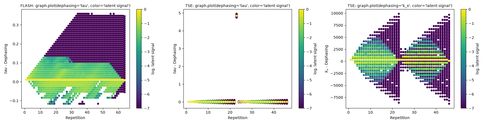

`graph.plot(dephasing="tau", color="latent signal")` draws only + states as
dots at the end of each repetition. In TSE, every spin echo sits at tau = 0,
so the tau view collapses to a line apart from the 4.85 s TR gap. The dead
states form the dominant purple mass, edges are not drawn, the pruning
threshold is not marked, and z states (the stimulated-echo memory) are
invisible.

## Views

### 1. Latent-weighted phase diagram (`fig02`): how echoes form

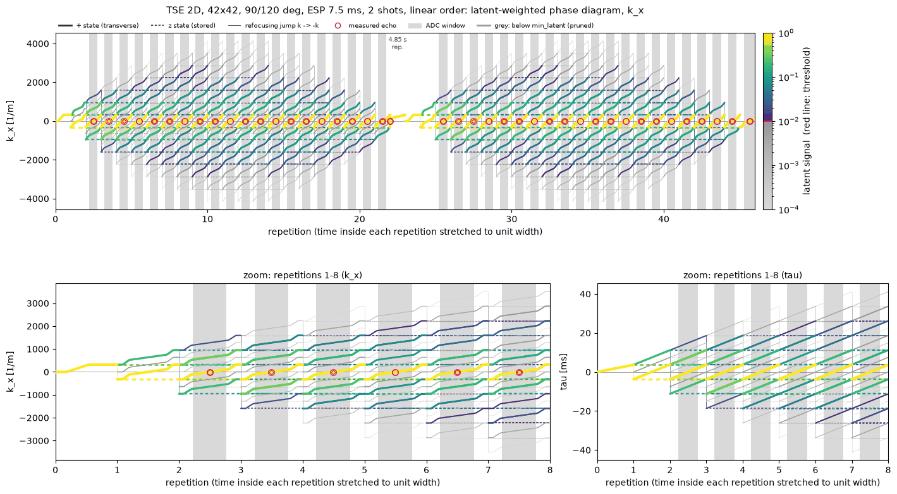

This is the textbook extended-phase-graph drawing, rebuilt from the PDG:

- + states are k(t) trajectories through each repetition, integrated from the
  gradient waveform.
- z states are dashed horizontal lines.
- Refocusing (`-+`, `-z` edges) is drawn as a jump k -> -k.
- ADC windows are shaded, and measured echoes are marked at the ADC centre.

The colour map is split at `min_latent`: grey below it (pruned), viridis above
it. The colourbar answers "is this state simulated?", and the line answers "what
does it do?". The tau view (bottom right) shows the spin-echo refocusing that
the end-of-repetition dots hide. Long repetitions are compressed to unit width
and labelled with their real duration.

### 2. Simulation budget (`fig03`): what the thresholds cost

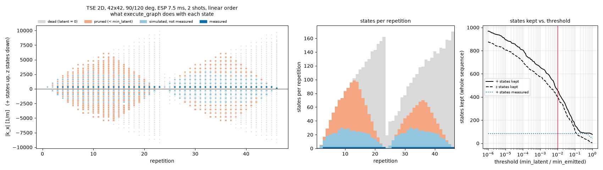

Every state is classified as dead (latent = 0), pruned (< `min_latent`),
simulated but not measured, or measured.

| | dead | pruned | simulated only | measured |
|---|---|---|---|---|
| FLASH | 2265 | 920 | 894 | 64 |
| TSE | 2492 | 1152 | 770 | 84 |

The middle panel shows the classes per repetition. The right panel shows states
kept against threshold, so you can see whether 1e-2 sits on a plateau or on the
steep part; for both sequences it is on the steep part.

### 3. Relaxation fingerprint (`fig04`): what each readout is weighted by

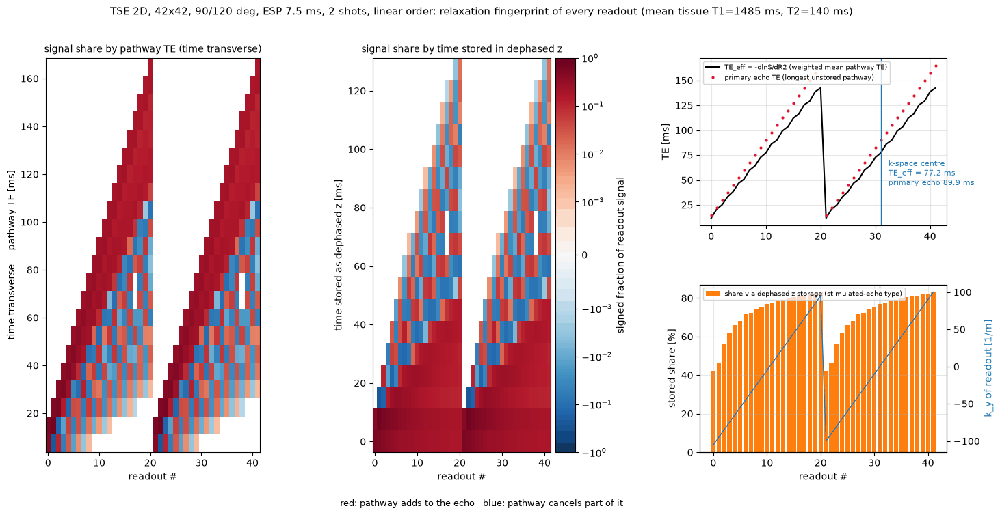

The prepass already contains the full history of every echo. `relaxation_paths`
walks the graph in time order and keeps, per state, a dict
`{(t2, t1s): complex amplitude}`:

- t2 is the time spent transverse; t1s is the time stored as dephased z.
- The per-repetition decay comes from the prepass itself (`mag / mag_start`),
  so k-dependent diffusion is included and the dicts sum to `prepass_mag`.
- History also flows through z0. In this FLASH (no slice-select gradient, fully
  rewound phase encoding), F-1 is back at k = 0, tau = 0 at the next pulse and
  feeds z0. Resetting the history there made TE_eff wrong by 13 % (median).

Each measured echo's pathways are projected on its total phase and normalised.
That gives a signed signal share per readout and pathway: red adds to the
echo, blue cancels part of it. Three numbers come out per readout:

- **TE_eff**, the signal-weighted mean of t2. For a fixed graph this is exactly
  `-dlnS/dR2`, the T2 weighting of that readout, in ms.
- The **primary echo TE**: the longest pathway that never went through z
  storage.
- The **stored share**: the fraction that went through dephased z storage
  (stimulated echoes).

For the TSE, the signed map shows the CPMG pathway fan:

- The primary echo is the top edge of the fan; stimulated pathways fill the
  rest.
- Pathways stored through a 120 deg pulse pick up cos(120 deg) < 0 and enter
  blue.
- At the k-space centre (readout 31), TE_eff is 77 ms against a primary echo at
  90 ms, and 77 % of the signal passed through z storage. The stored share rises
  from 42 % at the first echo to 83 % at the last.

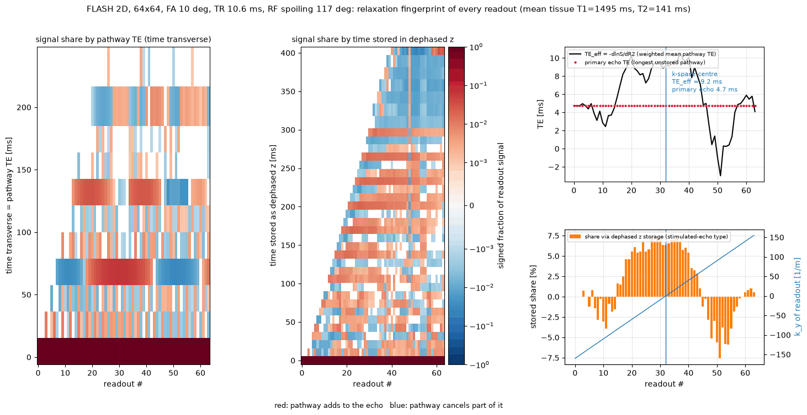

For the FLASH:

- The FID (4.7 ms) carries most of the signal.
- RF spoiling does not remove old coherences; it makes them cancel. The signed
  bands at n TR + TE change sign across the acquisition.
- Their net effect moves TE_eff between -3.0 ms (readout 51) and 10.6 ms
  (readout 37), and 9.2 ms at the centre. A negative TE_eff means the readout
  gets brighter when T2 shortens, because the cancelling coherences decay
  faster.
- This is a T2-dependent modulation along k-space that the nominal TE does not
  reveal.

### 4. Tissue signal and tissue RGB (`fig05`): which tissue, when, and which states

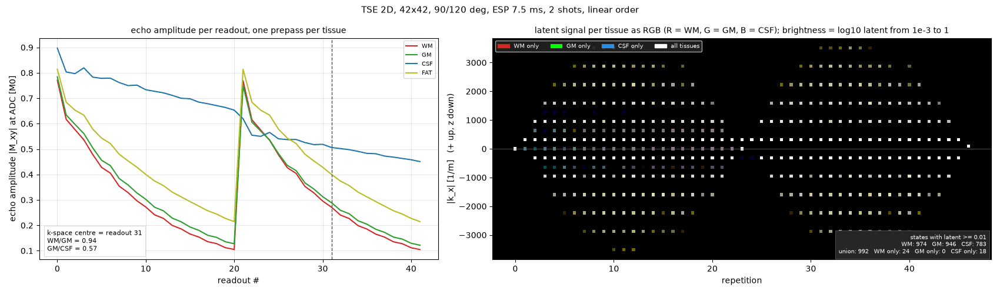

Left: echo amplitude per readout from one prepass per tissue (WM, GM, CSF, fat
from `state_selection.md`). It is the coherent sum of the measured states'
transverse magnetisation at the ADC centre, in M0 units. The k-space centre is
marked, and contrast ratios are printed there. This is the image contrast
without a reconstruction.

- **TSE**: WM/GM = 0.94 and GM/CSF = 0.57. CSF starts shot 2 at 0.62 instead
  of 0.90 (GM at 0.75 instead of 0.78, WM recovers fully). TR = 5 s is too short
  for CSF (T1 4.2 s), so CSF k-space lines differ shot by shot (ghosting and
  blurring in the phase-encoding direction).
- **FLASH**: WM/GM = 1.01 and GM/CSF = 0.99 at the centre. There are no dummy
  scans, so the signal is still relaxing towards steady state. T1 contrast
  (WM 0.088 > GM 0.078 > CSF 0.067) appears only at the last, outer lines.

Right: the latent signal of every state, as RGB (R = WM, G = GM, B = CSF).
White states are needed for all tissues; coloured states are needed for one
tissue only. Counts of states with latent >= 0.01:

| | WM | GM | CSF | union | only WM | only GM | only CSF |
|---|---|---|---|---|---|---|---|
| FLASH | 574 | 662 | 1206 | 1213 | 0 | 3 | 544 |
| TSE | 974 | 946 | 783 | 992 | 24 | 0 | 18 |

In FLASH, CSF needs twice as many states as WM: long-T2 coherences survive many
TRs. The mean-tissue graph that `compute_graph(seq, data, ...)` builds keeps
958 states, against the 1206 CSF needs. In TSE the tissues mostly need the same
states.

### 5. Contrast compass (`fig06`): T1 or T2 weighted, per readout

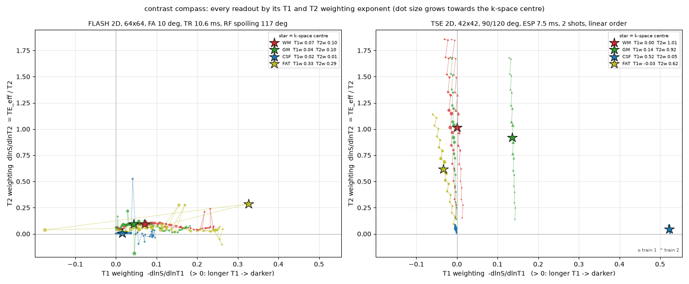

For each tissue, `relaxation_sensitivity` runs the prepass at T1 and T2 ±2 %
and takes `dlnS/dlnT` per readout.

- x = -dlnS/dlnT1 (T1 weighting: > 0 means a longer T1 gives a darker voxel).
- y = dlnS/dlnT2 (T2 weighting, equal to TE_eff / T2).

One line per tissue, broken at train boundaries, one marker shape per train,
and a star at the k-space centre. The position of the stars tells the contrast
type at a glance.

| | WM T1w / T2w | GM | CSF | fat |
|---|---|---|---|---|
| FLASH | 0.07 / 0.10 | 0.04 / 0.10 | 0.02 / 0.01 | 0.33 / 0.29 |
| TSE | 0.00 / 1.01 | 0.14 / 0.92 | 0.52 / 0.05 | -0.03 / 0.62 |

The compass shows sensitivity, not brightness. In the TSE, CSF is the brightest
tissue but barely T2-sensitive (TE_eff << T2), and it is the one clearly
T1-weighted tissue (incomplete recovery between shots). FLASH sits near the origin: weakly weighted, and its
fat contrast comes from T2' (0.40, not shown on these axes).

### 6. Dashboard (`fig07`): one page per sequence

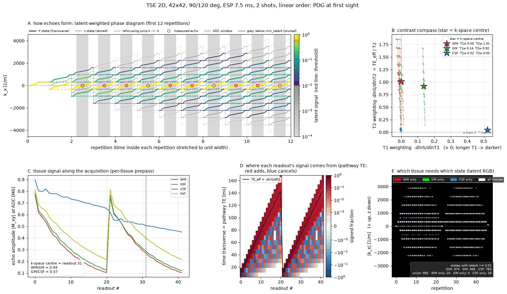
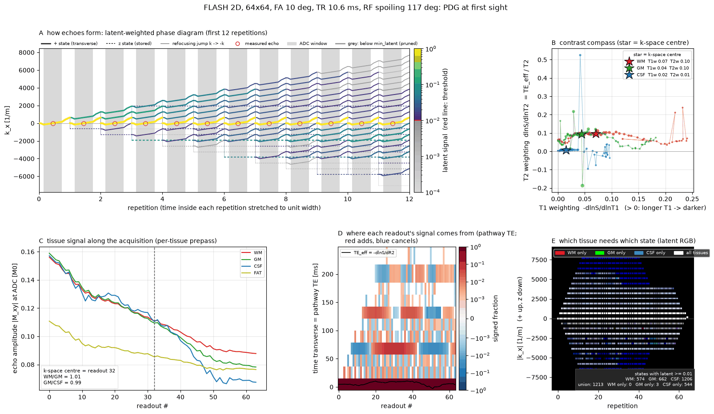

The dashboard combines five panels:

- A: the phase diagram of the first 12 repetitions (how echoes form).
- B: the compass (what contrast).
- C: the tissue curves (how much, and where in k-space).
- D: the signed pathway-TE map with TE_eff (where the signal comes from).
- E: the tissue RGB (what the simulation needs).

### 7. Diagnostics

**Prepass budget (`fig08`).** The notebook runs FLASH with
`compute_graph(seq, data, 200, 1e-3)` (4208 states). Comparing it with
`(2000, 1e-5)` (7105 states):

- The difference of the pathway maps shows what the smaller graph misplaces.
- At readout 48 the FID state has 1 ancestor instead of 3, and 4.8 % of its
  signal is re-attributed.
- Echo amplitudes differ by at most 1.2 %, and `execute_graph` differs by
  1.95 % relative L2.

The map shows *which* coherences are missing, not only that the error is small.

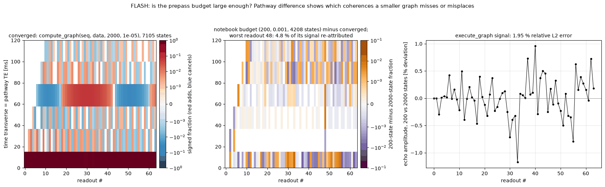

**RF spoiling (`fig09`).** Signed pathway-TE maps for the same FLASH with
increments of 0, 50, 117 and 150 deg (converged prepass). The metric is the
mean over readouts 20+ of the absolute net share per pathway TE beyond the FID:

| increment | 0 deg | 50 deg | 117 deg | 150 deg |
|---|---|---|---|---|
| leaked share | 39 % | 4.8 % | 6.7 % | 5.4 % |

- 0 deg (gradient spoiling only) gives large coherent bands.
- 117 deg gives a few strong bands (6 and 12 TRs) whose sign flips along the
  acquisition. The 6-TR band adds to the echo around the k-space centre and
  cancels at the edges.
- 50 and 150 deg spread the leak over many small, alternating bands.

In this short acquisition, with no dummy scans, 117 deg is not the smallest
leak. The classic 117 deg optimum targets steady-state T1 accuracy.

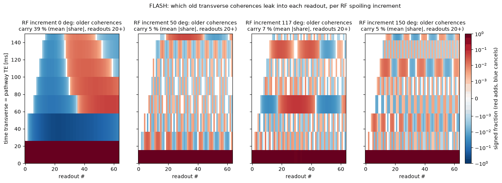

## Validation (`validate_pdg_viz.py`)

| check | FLASH | TSE |
|---|---|---|
| latent recomputed from the edges vs `latent_signal` (max abs) | 1.2e-8 | 6.1e-8 |
| pathway dicts summed vs `prepass_mag` (median rel) | 7.8e-7 | 3.3e-6 |
| TE_eff vs finite-difference `-dlnS/dR2`, T2 ±1 %, fresh prepass (median rel / max abs) | 0.12 % / 0.033 ms | 0.27 % / 0.43 ms |

The FLASH TE_eff check was off by 13 % until z0 kept the T2 history of the
states that refocus into it.

## Ideas for anyfield

- The PDG settings in `scan_zero/sim_backends.js` (`min_latent_signal`,
  `max_state_count`) could show the states-kept-vs-threshold curve and the
  class counts from view 2. It is cheap, needing only the prepass.
- TE_eff, the stored share and the compass need only the prepass and a graph
  walk, no `execute_graph` and no reconstruction. They fit next to
  `seq_check` as a per-readout contrast summary of any uploaded `.seq`.
- Prepass budget warning: comparing two budgets' pathway maps (view 7) flags
  missing merges before a full simulation.
- Tissue-aware state selection: the union of per-tissue latent sets (view 4)
  covers CSF in FLASH, which the mean-tissue graph under-represents.
